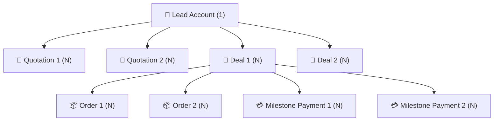

# 🛡️ SecureRegent Private Limited — Business Performance & Revenue Analytics Dashboard

> **Enterprise Admin Dashboard for Multi-Domain Revenue Operations, Conversion Funnels, and 1:N Relational Drill-Down Telemetry.**  
> Scaffolding and production execution for **SecureRegent Private Limited** (Front End Development Technical Assessment).

---

## 🌟 Executive Summary & Architectural Highlights

This platform is a production-grade, interactive executive analytics dashboard engineered to provide real-time visibility across the entire enterprise revenue lifecycle: **Leads ➔ Quotations ➔ Deals ➔ Orders ➔ Payments**.

Built with **Next.js 15, React 19, TypeScript, Tailwind CSS v4, and Recharts**, the application features:

1. **Deterministic 1:N Relational Data Model**:
   - **1 Lead** can have multiple **Quotations** and multiple **Deals**.
   - **1 Deal** can have multiple **Orders** and multiple **Milestone Payments**.
   - Full 360-degree interactive hierarchy explorer and slide-over inspection drawer.

2. **Automated Period Comparison Engine**:
   - Presets for **Today**, **Last 7 Days**, **Last 30 Days**, and **Custom Date Range**.
   - Computes normalized previous equivalent periods ($N$ days immediately prior) and presents exact percentage changes ($\pm\%$) and directional badges across all KPI cards and charts.
   - All charts, funnel stages, service breakdowns, and transaction ledgers react dynamically to filter changes.

3. **Multi-Domain Analytics Modules**:
   - **Lead Analytics**: KPI cards (Total, Qualified, Converted, Unqualified), conversion rates, 5-stage pipeline funnel with stage drop-off and monetary pipeline, status distribution donut, and channel acquisition ROI.
   - **Quotation Analytics**: Quotations volume and gross value by service and category, quotation status breakdown, service-wise performance matrix (average quote sizes, discounts, and quote-to-deal win rates), and lead-wise history.
   - **Deals & Revenue**: Deals and revenue by service line, category share, priority breakdown (High/Medium/Low), daily revenue trends with baseline comparison, total contracted vs. collected vs. outstanding revenue balance, and deal progress stages.
   - **Orders & Payments**: Order status breakdown, milestone fulfillment progress, completed delivery metrics, cash collection trends over time, and a searchable transaction ledger.
   - **Relational Drill-Down View**: Dedicated 1:N hierarchical cascade allowing reviewers to select any client account and inspect all attached quotations, contracts, orders, and receipts in a unified graph.

---

## 🏗️ System Architecture & Data Relationships



---

## 🚀 Tech Stack

- **Framework**: Next.js 15 (App Router, Server & Client Components)
- **UI Library**: React 19, Lucide React
- **Styling**: Tailwind CSS v4 (Modern `@import "tailwindcss"` engine with dark/light theming)
- **Data Visualization**: Recharts (ResponsiveContainer, AreaChart, BarChart, PieChart, Donut, Tooltips, Custom Gradients)
- **Effects & Polish**: Canvas Confetti, CSS Micro-interactions, Slide-over Drawer
- **Language**: TypeScript 5+ (Strict Type-Safety)

---

## ⚙️ Running Locally

```bash
# 1. Install dependencies
npm install

# 2. Run local development server
npm run dev

# 3. Deterministic verification
npx tsc --noEmit
npm run build
```

Open [http://localhost:3000](http://localhost:3000) to view the live dashboard.

---

## 📋 Evaluation Requirements Compliance Matrix

| Requirement | Implementation Details | Status |
|---|---|:---:|
| **1. Lead Analytics** | KPI cards (total, qualified, converted, unqualified, conversion rate); 5-stage conversion funnel with step drop-offs and pipeline value; status donut and source acquisition trends. | ✅ Verified |
| **2. Dynamic Filters & Baseline Comparison** | Presets for Today, Last 7 Days, Last 30 Days, Custom Range; normalized previous equivalent period calculation with $\pm\%$ delta badges; all charts update dynamically. | ✅ Verified |
| **3. Quotation Analytics** | Quotations by service and category; quotation value metrics; service-wise performance matrix; quotation status distribution; lead-wise quotation history; quote-to-deal conversion rates. | ✅ Verified |
| **4. Deals & Revenue** | Deals and revenue by service; revenue by category; priority breakdown (High, Medium, Low win rates); daily revenue trends vs. baseline; total vs. collected vs. outstanding revenue progress; deal stage progress. | ✅ Verified |
| **5. Orders & Payments** | Order status breakdown; fulfillment progress; completed orders; payment history ledger with references; daily collection trends over time. | ✅ Verified |
| **Data Relationships (1:N)** | 1 Lead ➔ Multiple Quotations & Deals; 1 Deal ➔ Multiple Orders & Payments; interactive 1:N cascade view + slide-over drawer accessible from any table row. | ✅ Verified |
| **Zero Backend Constraint** | Fully client-side reactive state with reproducible seed dataset and in-app re-seed capability. | ✅ Verified |

---

*Engineered with precision by Yash Jain for SecureRegent Private Limited.*
